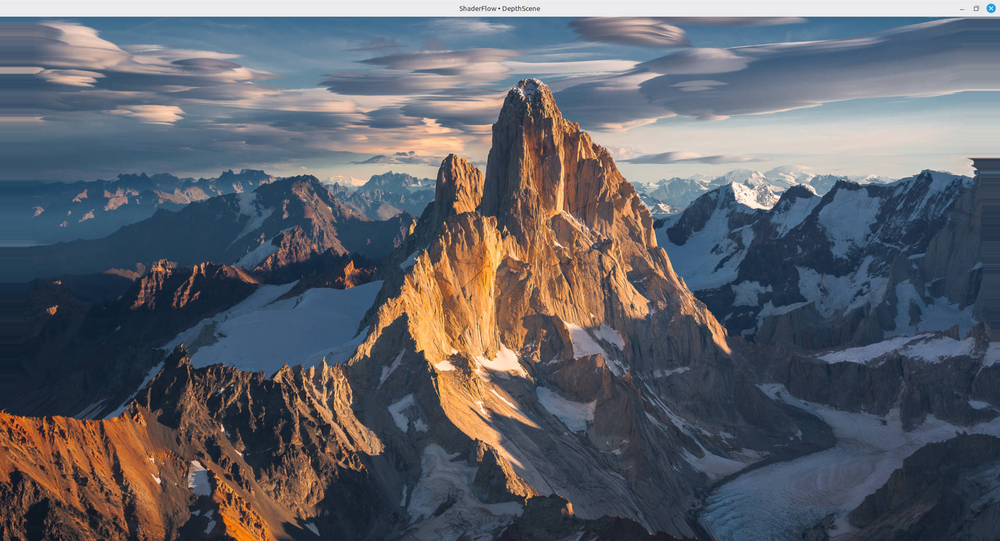
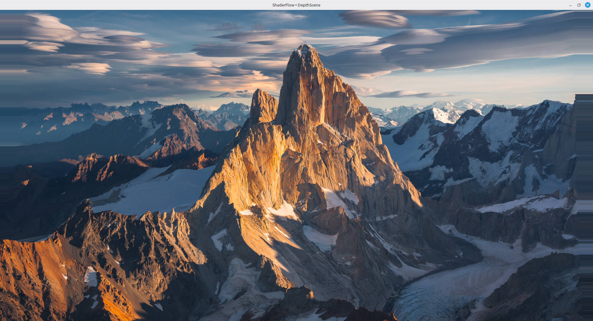
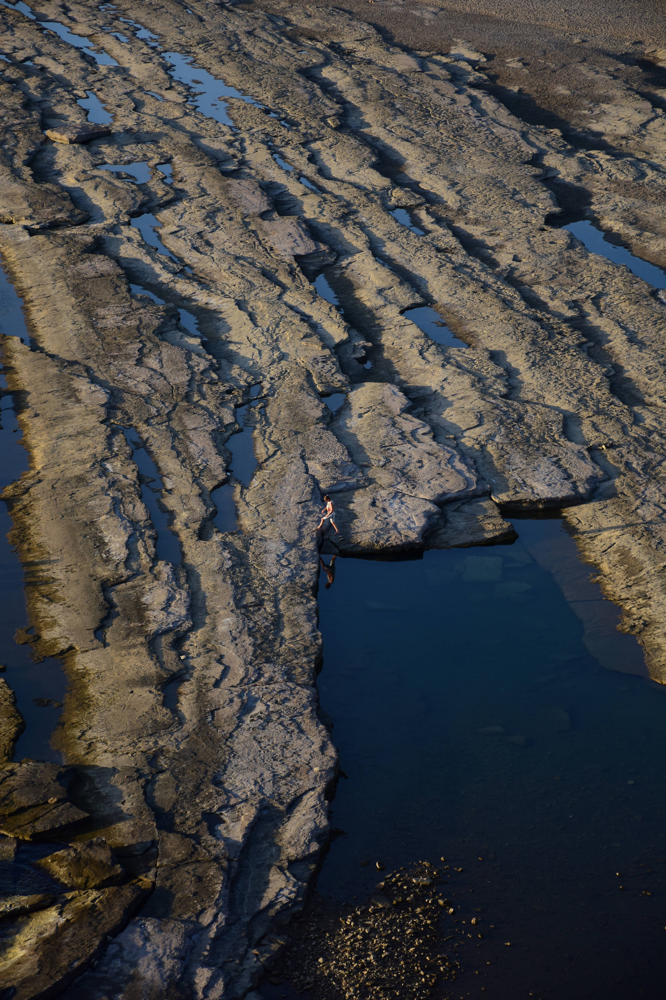

A couple of days ago, I saw a beautiful [video](https://www.instagram.com/reel/DfAr7YqTlYp/) on Instagram that is probably taken with a drone. I take lots of photographes during my travels. So I wondered whether I can convert some of my photographes into short videos as if they're recorded by a drone, in the age of ai.

I also wanted to do these processes locally on my computer. Then, I found [DepthFlow](https://github.com/BrokenSource/DepthFlow), an open source project for generating 3d parallax videos out of images.

## Installing DepthFlow

First of all, I've done all these work on Linux Mint. DepthFlow can be [installed](https://depth.tremeschin.com/get/pypi/#pip) using pip. 

First, create a directory, then create and activate a virtual environment:

```bash
python3 -m venv .venv
source .venv/bin/activate
```

Then install DepthFlow:

```bash
python -m pip install --upgrade pip
python -m pip install depthflow
```

DepthFlow also requires FFmpeg for video encoding. On Linux Mint, it can be installed using:

```bash
sudo apt install ffmpeg
```

To launch the program:
```bash
depthflow main
```

The program opens a default picture and you can drag the picture to see parallax effect using mouse.

<div style="text-align: center;">
 
</div>

<br>

<div style="text-align: center;">
 
</div>

I have a NVIDIA GeForce RTX 4070 SUPER gpu. At first, the window was very laggy because the program was not using nvidia gpu:

```bash
│0'00.273├┤info │ OpenGL Renderer: AMD Ryzen 7 9800X3D 8-Core Processor 
(radeonsi, raphael_mendocino, LLVM 20.1.2, DRM 3.64, 7.0.0-42-generic)
```

My system was using an open source nouveau driver. To check the available drivers:

```bash
ubuntu-drivers devices
```

I installed the recommended version and restarted the pc:

```bash
sudo apt update
sudo apt install nvidia-driver-595-open
```

But OpenGL was still using amd processor. To fix it, use Nvidia Prime Render Offload.

```bash
__NV_PRIME_RENDER_OFFLOAD=1 __GLX_VENDOR_LIBRARY_NAME=nvidia depthflow main
```

There is no lag anymore.

## Creating a video
When running DepthFlow for the first time, it will download a model called DepthAnythingV2 small. This is a monocular depth estimation model. It takes an image and predicts a depth value for each pixel.

I created videos using the presets.py file which is under the examples folder of library directory. I changed it according to my needs. To get a drone-like effect, I added this class into the presets.py file:

```python
@define
class Horizontal2(DepthScene):
    """5 saniyede soldan sağa tek yönlü parallax"""

    def update(self):
        progress = min(max(self.time / 10.0, 0.0), 1.0)

        start_x = -0.40
        end_x = 0.40

        x = start_x + (end_x - start_x) * progress

        self.state.offset = (x, 0.0)
        self.state.isometric = 0.60
        self.state.steady = 0.30
```

And main:

```python
if __name__ == "__main__":
    scene = Horizontal2()
    scene.input(image="DSC_5712.JPG")
    scene.main(output="video_5712_default_model.mp4",
    width=1000,
    height=1500,
    fps=30,
    time=10)
```

This creates a 10 seconds video with the default model. To create a video using nvidia gpu:

```bash
__NV_PRIME_RENDER_OFFLOAD=1 __GLX_VENDOR_LIBRARY_NAME=nvidia python presets.py
```

The picture:

<div style="text-align: center;">
 
</div>

<br>

The output:

<div style="text-align: center;">
<video style="width: 100%; max-width: 450px; height: auto;" controls autoplay loop muted>
  <source src="/assets/image/2026_parallax_video/video_5712_default_model.mp4" type="video/mp4">
  Your browser doesnt support html video tag.
</video>
</div>

The parallax video output is actually quite good. The image pans smoothly from left to right. However, at the very beginning of the camera movement, the person's head appears to be tilted unnaturally far forward. That's why I decided to experiment with other models.

To execute the script using large model we can change the main:
```python
if __name__ == "__main__":
    scene = Horizontal2()
    scene.estimator = DepthAnythingV2(model="large")
    scene.input(image="DSC_5712.JPG")
    scene.main(output="video_5712_default_large_model.mp4",
    width=1000,
    height=1500,
    fps=30,
    time=10)
```
The result is similar:

<div style="text-align: center;">
<video style="width: 100%; max-width: 450px; height: auto;" controls autoplay loop muted>
  <source src="/assets/image/2026_parallax_video/video_5712_default_large_model.mp4" type="video/mp4">
  Your browser doesnt support html video tag.
</video>
</div>

At this point, I wanted to try an external model. While DepthFlow doesn't support an external model directly in the code, it accepts external depth map file. Thus, we can create a depth map using a model and give it to depthflow.

## DepthAnything3 DA3MONO-Large

[This](https://huggingface.co/depth-anything/DA3MONO-LARGE) is another monocular depth estimation model.

Create another directory if you want to try it and clone the project:

```bash
git clone https://github.com/ByteDance-Seed/Depth-Anything-3.git
```

Create a new viritual environment fo python in the directory and activate it:
```bash
python3 -m venv .venv
source .venv/bin/activate
```

Then:
```bash
python -m pip install -e .
```

During an earlier attempt, I encountered package configuration issues. Later, when importing the API, I received:

```bash
ModuleNotFoundError: No module named 'addict'
```

Fix the error by installing the dependency:

```bash
python -m pip install addict
```

Then I generated this code using ai to get a depth map using this model:

generate_depth.py

```python
import sys
import numpy as np
import torch

from PIL import Image
from depth_anything_3.api import DepthAnything3

image_path = sys.argv[1]
output_path = sys.argv[2]

model = DepthAnything3.from_pretrained(
    "depth-anything/DA3MONO-LARGE"
).to("cuda")

prediction = model.inference([image_path])

depth = np.asarray(prediction.depth[0], dtype=np.float32)
depth = np.squeeze(depth)

valid = np.isfinite(depth) & (depth > 0)

if not np.any(valid):
    raise RuntimeError("Could not find a valid depth value")

near = np.percentile(depth[valid], 2)
far = np.percentile(depth[valid], 98)

normalized = np.clip(
    (depth - near) / max(far - near, 1e-6),
    0,
    1
)

# DepthFlow: closer = white, far away = black
depth_image = ((1.0 - normalized) * 255).astype(np.uint8)
depth_image[~valid] = 0

with Image.open(image_path) as original:
    size = original.size

result = Image.fromarray(depth_image, mode="L")
result = result.resize(size, Image.Resampling.BICUBIC)
result.save(output_path)

print(f"Depth map is created: {output_path}")
```

This script takes to parameters, file_path and output_path:

```bash
python generate_depth.py DSC_5712.JPG DSC_5712_map.png
```

The depth map of the picture:

<div style="text-align: center;">
 
</div>

To get an output using this map, copy this map into the same folder with presets.py file and then change the main:
```python
if __name__ == "__main__":
    scene = Horizontal2()

    scene.input(image="DSC_5712.JPG", depth="DSC_5712_depth_anything_3_da3mono_large_map.png")
    scene.main(output="DSC_5712_depth_anything_3_da3mono_large_video.mp4",
    width=1000,
    height=1500,
    fps=30,
    time=10)
```

The result is not so good:
<div style="text-align: center;">
<video style="width: 100%; max-width: 450px; height: auto;" controls autoplay loop muted>
  <source src="/assets/image/2026_parallax_video/DSC_5712_depth_anything_3_da3mono_large_video.mp4" type="video/mp4">
  Your browser doesnt support html video tag.
</video>
</div>

Then I decided to use another model.

## Microsoft's MoGe-2
This model doesn't estimate relative depth. MoGe predicts scene geometry. To use this model

Create another directory and clone the repository:

```bash
git clone https://github.com/microsoft/MoGe.git
```

Create and activate virtual environment:

```bash
python3 -m venv .venv
source .venv/bin/activate
```

Install the project:

```bash
python -m pip install --upgrade pip
python -m pip install -e .
```

To create depth output:

```bash
moge infer \
  --input my_files/DSC_5712.JPG \
  --version v2 \
  --pretrained Ruicheng/moge-2-vitl \
  --device cuda \
  --fp16 \
  --output my_files/output \
  --maps
```

But I encountered a problem when I execute this command:

```bash
cv2.error: could not find a writer for the specified extension
```

To enable OpenEXR support:

```bash
OPENCV_IO_ENABLE_OPENEXR=1 moge infer \
  --input my_files/DSC_5712.JPG \
  --version v2 \
  --pretrained Ruicheng/moge-2-vitl \
  --device cuda \
  --fp16 \
  --output my_files/output \
  --maps
```

I still got the same error and I had to install another version of OpenCV with EXR support.

When I run this command:
```bash
python -m pip list | grep -i opencv
```
Result:
opencv-python-headless 5.0.0.93

Because [OpenCV 5 doesn't contain OpenEXR](https://docs.opencv.org/doc/doxygen/html/db/d05/tutorial_config_reference.html?utm_source=chatgpt.com#:~:text=(EXR)%20OpenCV%205%20doesn%27t%20contain%20OpenEXR%20source%20code%2C%20so%20BUILD_OPENEXR%20is%20not%20supported.%20Users%20must%20provide%20a%20system%2Dwide%20installation%20of%20libopenexr.) source code, I uninstalled this version and installed another one with OpenEXR:

```bash
python -m pip uninstall -y opencv-python-headless
python -m pip install "opencv-python-headless==4.11.0.86"
```
Then we can run the command again:

```bash
OPENCV_IO_ENABLE_OPENEXR=1 moge infer \
  --input my_files/DSC_5712.JPG \
  --version v2 \
  --pretrained Ruicheng/moge-2-vitl \
  --device cuda \
  --fp16 \
  --output my_files/output \
  --maps
```

Now we have an exr file under output/DSC_5712/. To convert it into 
a depth map I tried a couple of python code and with this one I got 
a good result:

exr_to_depthflow.py
```python
import os
import sys

os.environ["OPENCV_IO_ENABLE_OPENEXR"] = "1"

import cv2
import numpy as np


def convert_exr_to_depthflow(input_path, output_path):
    depth = cv2.imread(input_path, cv2.IMREAD_UNCHANGED)

    if depth is None:
        raise RuntimeError(f"EXR dosyası okunamadı: {input_path}")

    if depth.ndim == 3:
        depth = depth[:, :, 0]

    depth = depth.astype(np.float32)

    valid = np.isfinite(depth) & (depth > 0)

    if not np.any(valid):
        raise RuntimeError("Geçerli derinlik değeri bulunamadı")

    near, far = np.percentile(depth[valid], [2, 98])

    if far <= near:
        raise RuntimeError("Derinlik aralığı geçersiz")

    inverse = 1.0 / np.maximum(depth, 1e-6)

    near_inv = 1.0 / near
    far_inv = 1.0 / far

    normalized = np.clip(
        (inverse - far_inv) / (near_inv - far_inv),
        0,
        1
    )

    normalized[~valid] = 0.0

    depth_png = (normalized * 255).astype(np.uint8)

    if not cv2.imwrite(output_path, depth_png):
        raise RuntimeError(f"PNG kaydedilemedi: {output_path}")

    print(f"Depth map: {output_path}")
    print(f"Near: {near:.4f}, Far: {far:.4f}")
    print(f"Resolution: {depth.shape[1]}x{depth.shape[0]}")


if __name__ == "__main__":
    if len(sys.argv) != 3:
        print("Usage: python exr_to_depthflow.py input.exr output.png")
        sys.exit(1)

    convert_exr_to_depthflow(sys.argv[1], sys.argv[2])
```

To get the map, run:
```bash
python exr_to_depthflow.py output/DSC_5712/depth.exr DSC_5712_moge_depth_map.png
```

The result:

<div style="text-align: center;">
 
</div>

You can see that there is a lot of detail in this depth map.

Then, using this map, I created a new video with depthflow and the 
result is actually great.

<div style="text-align: center;">
<video style="width: 100%; max-width: 450px; height: auto;" controls autoplay loop muted>
  <source src="/assets/image/2026_parallax_video/DSC_5712_moge_video.mp4" type="video/mp4">
  Your browser doesnt support html video tag.
</video>
</div>